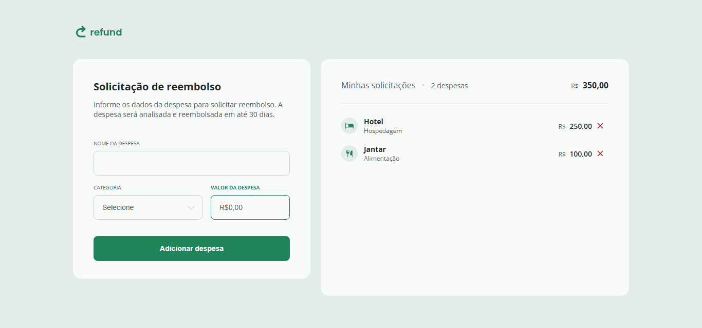

# Refund
Um site que simula uma situação de reembolso(gastos com viagens a trabalho e etc...). Nele foram utilizados HTML e CSS para a estilização, estruturação e responsividade. Além do JS fazendo a parte lógica e criando a interatividade
  

